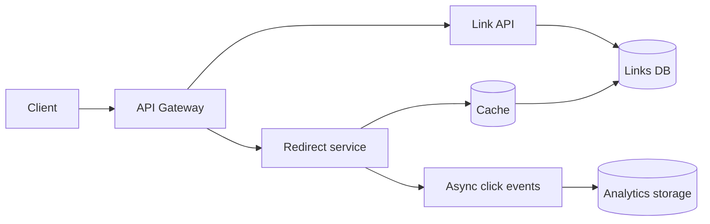

# System design notes — link shortener

## Requirements

- Create links; redirect quickly; expire links; inspect simple click counts.
- Assume **1 million new links/day** and **100 million redirects/day** as planning estimates, not measured traffic.
- Average request rate: ~12 writes/s and ~1,157 reads/s. Peaks can be much higher.

## Data flow

## Why I built the prototype differently

To keep it runnable on a laptop I used a single SQLite table and a direct hit counter. That meets the **functional** requirement but creates contention on popular links. At scale: a PostgreSQL primary for writes; read replicas or cache for code resolution; nonblocking click events; partitioned analytics; and expiry cleanup.

## Capacity thought experiment

If each stored link (including index overhead) takes roughly 300 bytes, 1 million/day is ~300 MB/day or ~110 GB/year before replication. Real record size and traffic distribution need measurement.

## Failure and security questions

- What happens when the cache or database is unavailable? Which redirect behavior is acceptable?
- How are malicious or phishing destinations blocked?
- How are abusive callers throttled and anonymous links removed?
- Short codes must be unpredictable enough to resist easy enumeration; collision retries are necessary.
- Redirects must use only approved URL schemes.

## Tests

Normal create/redirect, expiry, malformed destination, and collision exhaustion. No benchmark or distributed test has been executed.
