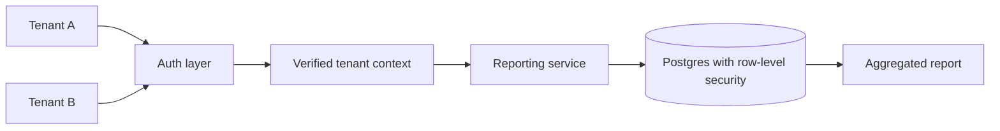

# Multi-tenant reporting design

## First choice: isolation model

The prototype uses shared tables and a `tenant_id` column. It is resource-efficient but requires careful scoping of every query. Other choices are separate schemas or separate databases per tenant (better isolation, higher operational cost).

## Guardrails for a real implementation

1. Derive tenant ID from the **verified identity**, never an untrusted request field.
2. Make repository query functions require tenant ID explicitly.
3. Add PostgreSQL row-level security as defense in depth.
4. Use tenant-scoped cache keys (`tenant:resource:id`) to prevent cache leaks.
5. Test cross-tenant read, update and delete attempts, including admin functions.
6. Record access logs without exposing secrets or sensitive data.

## Trade-offs

A shared schema is simpler for a university project. It needs stricter access controls at scale and noisy-neighbor mitigation. The proof-of-concept is single-process SQLite with hardcoded demo keys; it does not claim production security.
