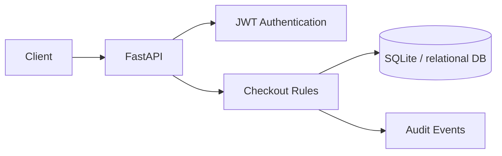

# Design notes — Order API

Tables: `users`, `products`, `orders`, `order_items`, `audit_events`.

A checkout takes an idempotency key, checks for an earlier order for that customer, and conditionally decrements product stock inside one transaction. If an item is unavailable, the transaction rolls back including any earlier item decrements. The database unique constraint helps prevent duplicate keys. Concurrent duplicate requests may return 409 rather than replaying a previous result. No payment, external queue or shipping provider is included.

Failure modes to test: unavailable stock, repeated checkout, duplicate SKUs, unknown product, cross-user order reads, and cancel-after-fulfillment.
