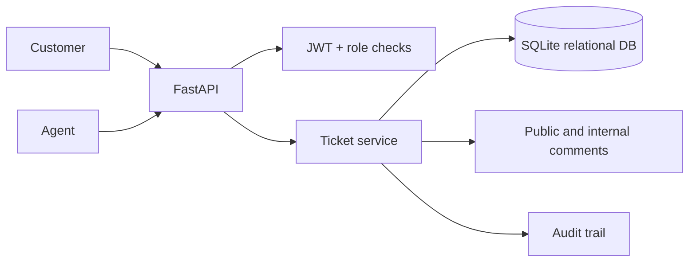

# Design notes — Support Ticketing

Tables: `users`, `tickets`, `comments`, `ticket_events`. There are two permission layers: row visibility for ticket ownership and field visibility to hide internal comments. A ticket cannot jump directly from `open` to `resolved`; `closed` is terminal. Tests check those assumptions.

Tradeoff: this service is synchronous and SQLite-based to keep it simple. No actual SLA scheduler is implemented, and staff authentication/authorization would need external identity management for real deployment.
