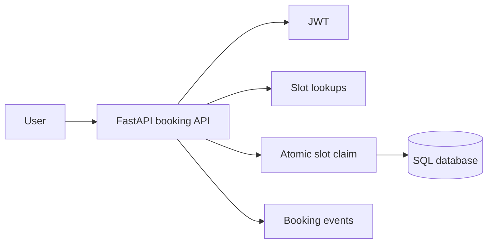

# Design notes — Booking

Tables: `users`, `services`, `slots`, `bookings`, `booking_events`. The unique constraint `(service_id, starts_at)` ensures there is at most one slot per service/time. Conditional writes ensure an available slot may only be claimed by a single successful transaction. Cancellation is a state change plus release inside one transaction.

Run tests for double-booking, idempotent retry, cancellation and access control. No payment capture or real scheduling frontend is shipped.
